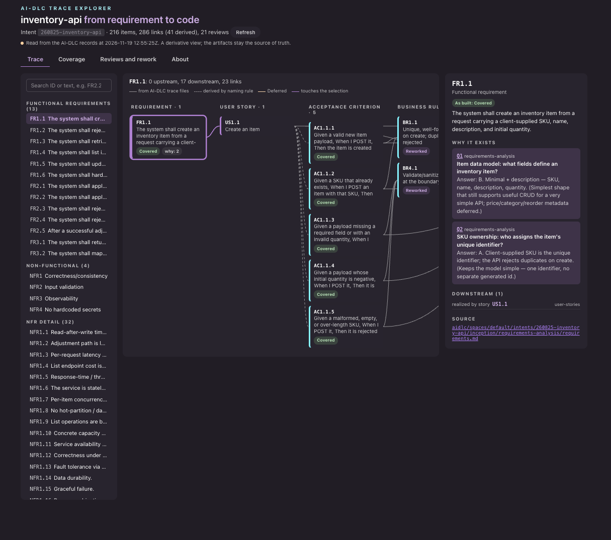
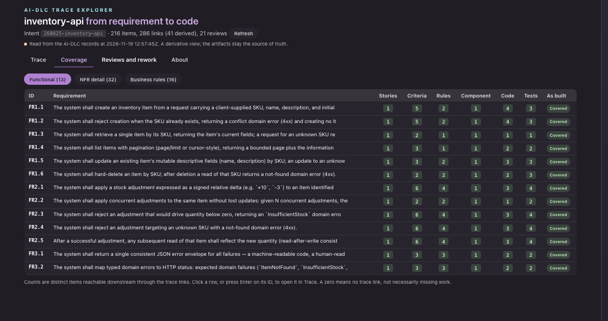
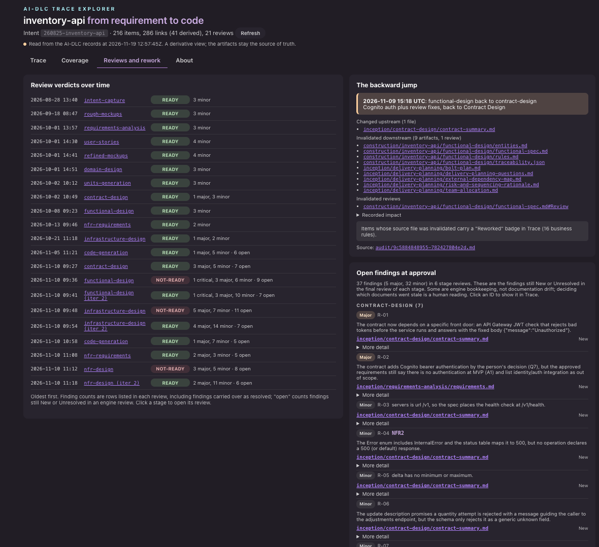
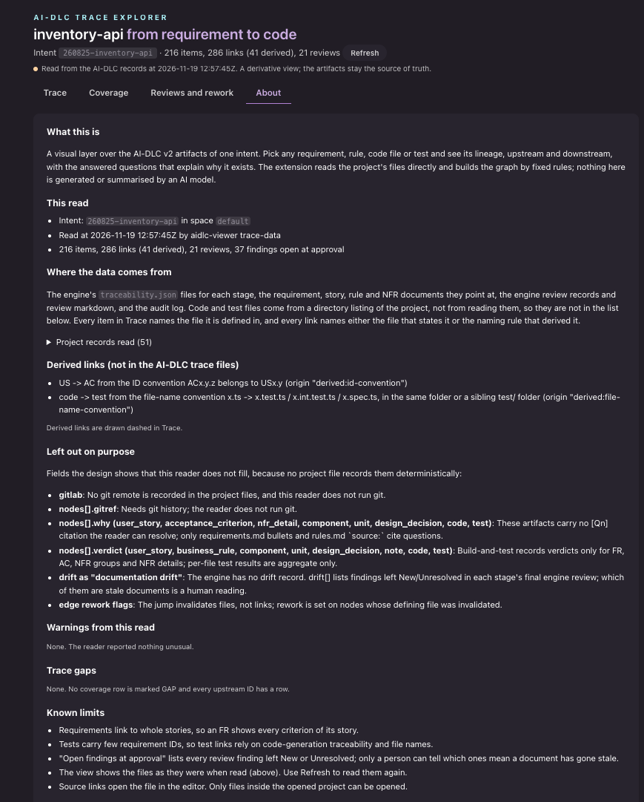

# Trace Explorer

The Trace Explorer (v0.2.0) is a panel that reads an AI-DLC v2 project and shows, for any
requirement, story, acceptance criterion, business rule, code file or test, where it came from and what
it led to. It only reads files: it never runs `aidlc`, writes into the project, or opens chat.

## Open it

Open a folder with an AI-DLC v2 project (an `aidlc/spaces/.../intents/...` tree). In the AI-DLC Viewer
side panel click **Trace Explorer**, or run **AI-DLC: Trace Explorer** from the Command Palette. The
header shows the intent and what was read. **Refresh** re-reads the files; the panel also refreshes when
files under `aidlc/` change. Markdown links open rendered, beside the panel, at the linked line.

## Trace

Pick an item on the left or search by ID. The middle shows its lineage in swim lanes (requirement → user
story → acceptance criteria → business rules → design decisions → code → tests); the right shows details,
the answered clarifying questions that explain why it exists, and its source file. Solid lines come from
the engine's `traceability.json` files, dashed lines from a naming rule, amber lines are deferred.



## Coverage

The traceability matrix: each number counts the distinct items reachable downstream through trace links.
Switch between functional requirements, NFR details and business rules; press Enter on an ID to open it in
Trace.



## Reviews and rework

Every review verdict the engine recorded, in order; the backward jump (what changed upstream and which
files and reviews it invalidated); and the findings still open when each stage was approved.



## About

What was read, which links are derived by which rule, what the reader leaves out and why, warnings and
known limits.



## Design notes

- [data-model.md](data-model.md): how the engine's records become the graph, and what can and can't be derived.
- [msg-protocol.md](msg-protocol.md): messages between the panel and the extension host.
- [css-mapping.md](css-mapping.md): theme variables, classes and contrast.
- [view-interface.md](view-interface.md): how the view modules plug into the panel.

## Develop

```bash
npm run verify                                        # syntax check + all tests
node tools/trace-preview.js tests/fixtures/inventory-api   # standalone HTML preview (?theme=dark|hc|hc-light)
```

`tests/fixtures/inventory-api/` is a trimmed, scrubbed copy of a completed AI-DLC v2 run used by the tests.
