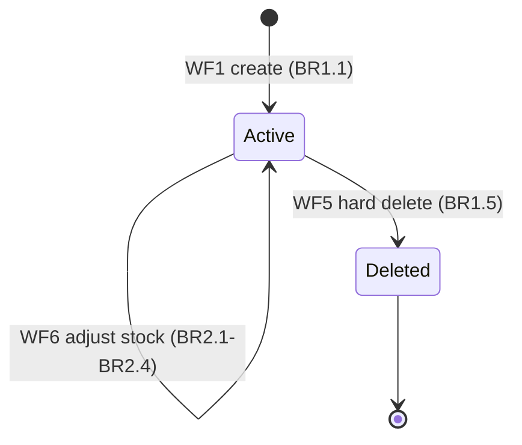
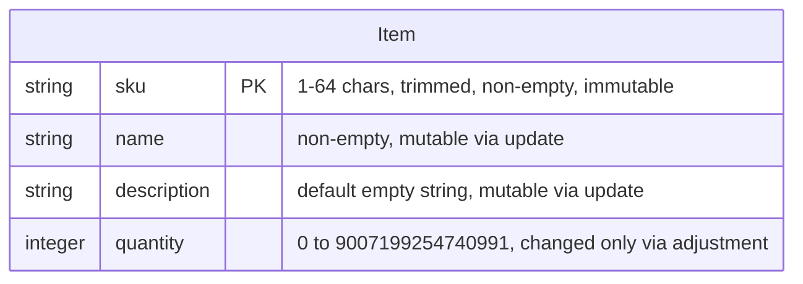

# Functional Specification — inventory-api (U1)

> The behavioural specification: the ordered workflows each use case follows and
> the `Item` lifecycle state transitions. This file is the **source of truth for
> workflows and state machines**. It also carries two **derived** views for
> readability — an entity-relationship diagram (derived from `entities.md`, which
> is source of truth for data shape) and a rules summary (derived from
> `rules.md`). Business logic is technology-agnostic.

## Sources

- `entities.md` (this stage) — the `Item` entity (source of truth for shape).
- `rules.md` (this stage) — BR1.1–BR5.2 (source of truth for decision logic).
- `requirements`, `components`, `contract-summary` (upstream) — the FRs/NFRs,
  the typed domain errors, and the REST contract these workflows realize,
  including Cognito JWT auth on every item route (contract Q7, Q8), the offset
  cap (Q11), and overflow rejection (Q10).
- `unit-of-work` / `unit-of-work-story-map` — US1.1–US4.2 realized by U1.
- `stories.md` (User Stories) — the acceptance criteria (`ACx.y.z`) of
  US1.1–US4.2 that this Unit implements.

## Layering context

Every item route first passes the API Gateway JWT check (WF-AUTH), outside the
service. Inside, all workflows run through the team's handler → service →
repository layering:
the **handler** parses/validates the request at the boundary (BR4.1) and shapes
the response/error envelope (BR3.1/BR3.2); the **service** holds the business
rules (SKU uniqueness, the atomic adjustment, the zero floor); the
**repository** owns persistence to the datastore. The workflows below describe
behaviour across these layers without prescribing implementation.

## Workflows

### WF-AUTH — Token check on every item route (cross-cutting, BR6.1)

1. Every request to an `/items` route meets the edge token check before the
   service (the contract's Cognito user pool, checked by the API Gateway JWT
   authorizer).
2. If the `Authorization: Bearer <token>` header is missing, or the token is not
   a valid JWT from that user pool → `401` with the gateway's own body
   `{"message":"Unauthorized"}`. The service never runs, nothing is validated
   or persisted, and the request is recorded in the gateway access log rather
   than the service log (BR5.1).
3. Otherwise the request continues into the workflow below. `GET /health`
   (WF7) skips this check.

### WF1 — Create item (US1.1 / FR1.1, FR1.2)

1. Receive `POST /items` with `{ sku, name, quantity, description? }`.
2. Validate at the boundary (BR4.1): SKU trimmed, non-empty, length 1–64; name
   non-empty; quantity a non-negative integer. On failure → `ValidationError`
   (400). → **WF-ERR**.
3. Default `description` to `""` when omitted (BR1.1 / Q1).
4. Attempt to create the item enforcing SKU uniqueness (BR1.1). If a item with
   that SKU exists → `DuplicateSku` (409), write nothing. → **WF-ERR**.
5. Persist the new item in state `Active` with the supplied initial quantity.
6. Return `201 Created` with the full `Item` (including `description`, possibly
   `""`).

### WF2 — Get item (US1.2 / FR1.3)

1. Receive `GET /items/{sku}`.
2. Validate the SKU path parameter (BR4.1).
3. Load by SKU. If absent → `ItemNotFound` (404). → **WF-ERR**.
4. Return `200 OK` with the `Item`.

### WF3 — List items (US1.3 / FR1.4)

1. Receive `GET /items?limit=&offset=`.
2. Validate pagination (BR1.4 / BR4.1): limit 1–100 (default 20), offset
   0–10000 (default 0). Out of range → `ValidationError` (400). → **WF-ERR**.
3. Load the bounded page and the total count.
4. Return `200 OK` with `{ items, total, limit, offset }`. The caller computes
   the next page as `offset + limit` (more remain while `offset + limit < total`).

### WF4 — Update item descriptive fields (US1.4 / FR1.5)

1. Receive `PUT /items/{sku}` with a payload restricted to `name` and/or
   `description`.
2. Validate (BR4.1) and enforce the field allow-list (BR1.3): an empty payload,
   or any other field including `quantity`, → `ValidationError` (400). →
   **WF-ERR**.
3. Load by SKU. If absent → `ItemNotFound` (404). → **WF-ERR**.
4. Apply the provided `name` and/or `description`; leave `quantity` unchanged.
5. Return `200 OK` with the updated `Item`.

### WF5 — Delete item (US1.5 / FR1.6)

1. Receive `DELETE /items/{sku}`.
2. Validate the SKU (BR4.1).
3. Hard-delete by SKU (BR1.5). If absent → `ItemNotFound` (404). → **WF-ERR**.
4. Transition the item to `Deleted` (removed from storage).
5. Return `204 No Content`. A later `GET` of that SKU returns `ItemNotFound`.

### WF6 — Adjust stock (US2.1, US2.2 / FR2.1–FR2.5)

1. Receive `POST /items/{sku}/adjustments` with `{ delta }`.
2. Validate (BR2.1 / BR4.1): `delta` present, integer, non-zero, within
   ±9007199254740991. On failure → `ValidationError` (400). → **WF-ERR**.
3. Apply the adjustment **atomically and concurrency-safely** (BR2.3) as one
   logical operation that, against the item's current quantity, checks in this
   order and commits only if every check passes:
   - the SKU exists, else `ItemNotFound` (404);
   - `current + delta >= 0`, else `InsufficientStock` (409), quantity unchanged
     (BR2.2);
   - `current + delta <= 9007199254740991`, else `ValidationError` (400),
     quantity unchanged (BR2.1).
   Any failure → **WF-ERR** with nothing written. Concurrent adjustments cannot
   lose updates. If the datastore reports a transient write conflict, retry
   internally a bounded number of times; never surface the conflict.
4. On success the new quantity is committed. The item stays `Active`.
5. Return `200 OK` with the `Item` carrying the new quantity (read-after-write
   consistent, BR2.4).

### WF7 — Health check (US4.2 / NFR3)

1. Receive `GET /health`. No token is required (BR6.1).
2. Return `200 OK` with `{ status: "ok" }` when able to serve (BR5.2).

### WF-ERR — Error envelope (cross-cutting, US3.1 / FR3.1, FR3.2)

Every failure path the service itself returns produces the single envelope
(BR3.1) and maps its typed domain error to a fixed status (BR3.2):
`ValidationError`→400, `ItemNotFound`→404, `DuplicateSku`→409,
`InsufficientStock`→409, unexpected→`InternalError` 500 (logged). Each response
and its structured log entry share the same `requestId` (BR5.1). The one
exception is the 401 from WF-AUTH, which the gateway returns with its own body
before the service runs.

### Cross-cutting — boundary validation (US4.1 / NFR2)

BR4.1 is applied as the validation step of WF1–WF6, before any domain or
datastore logic, and realizes US4.1 / NFR2.

### Cross-cutting — per-request logging (US4.2 / NFR3)

Every workflow that reaches the service emits one structured log entry on
completion (BR5.1): `requestId`, `timestamp`, `method`, `route`, `statusCode`,
`latencyMs`, `outcome`. No bodies, no secrets. A 401 from WF-AUTH is recorded in
the gateway access log instead.

## Item State Machine

The `Item` lifecycle is deliberately simple; `quantity` is item data that
changes within the `Active` state via WF6, not a lifecycle state.



<!-- Text fallback: An Item is created into the Active state (WF1). While Active
it accepts descriptive-field updates (WF4) and stock adjustments (WF6), both of
which return it to Active. A hard delete (WF5) moves it to Deleted, after which
it no longer exists and any read returns ItemNotFound. There is no soft-delete
or archived state at MVP. -->

## Entity-Relationship View (derived from entities.md)



<!-- Text fallback: One entity, Item, keyed by sku (primary key, 1-64 chars). It
carries name (non-empty), description (defaults to empty string), and quantity
(non-negative integer, changed only via the adjustment path). No relationships —
a single flat collection. See entities.md for the authoritative shape. -->

## Rules Summary (derived from rules.md)

| ID | Statement | Workflow(s) |
|----|-----------|-------------|
| BR1.1 | Unique, well-formed SKU on create; duplicate rejected | WF1 |
| BR1.2 | Operate by SKU; unknown SKU → not found | WF2, WF4, WF5, WF6 |
| BR1.3 | Update changes only name/description | WF4 |
| BR1.4 | List uses offset/limit (limit default 20, max 100; offset max 10000) | WF3 |
| BR1.5 | Hard delete; later read is not-found | WF5 |
| BR2.1 | Adjustment delta is a signed non-zero integer; overflowing result rejected | WF6 |
| BR2.2 | Below-zero adjustment rejected, quantity unchanged | WF6 |
| BR2.3 | Concurrent adjustments lossless; conflict never surfaced | WF6 |
| BR2.4 | Read-after-write consistency after adjustment | WF6, WF2 |
| BR3.1 | Single consistent error envelope (401 excepted) | WF-ERR |
| BR3.2 | Typed-error → HTTP status mapping; unexpected → 500 | WF-ERR |
| BR4.1 | Validate/sanitize all inputs at the boundary | WF1–WF6 |
| BR4.2 | No hardcoded secrets | all (config) |
| BR5.1 | Structured per-request log with fixed field set | all |
| BR5.2 | Health-check endpoint (open) | WF7 |
| BR6.1 | Cognito JWT required on every item route | WF-AUTH |

## Review

**Verdict:** READY
**Reviewer:** aidlc-architecture-reviewer-agent
**Date:** 2026-10-08T09:23:29Z
**Iteration:** 1

### Findings

| # | Severity | Location | Finding | Recommendation |
|---|---|---|---|---|
| 1 | Minor | functional-spec.md — Workflows / Rules Summary vs traceability.json AC4.1.1 | US4.1 (boundary input validation, NFR2) is the only one of the ten stories never cited by its story ID anywhere in functional-spec.md. It is covered **behaviourally** — BR4.1 appears as a validation step in WF1–WF6 and in the Rules Summary row (`WF1–WF6`), and traceability.json maps AC4.1.1 → BR4.1 — so there is no coverage gap. But the attribution is asymmetric: WF-ERR names US3.1, WF7 names US4.2, yet no workflow or cross-cutting note names US4.1/NFR2. A reader auditing per-story coverage from the spec prose alone (not the traceability file) would not find US4.1. | Non-blocking. Add US4.1/NFR2 to the existing "Cross-cutting" validation framing (e.g. a one-line note that BR4.1 across WF1–WF6 realizes US4.1/NFR2, mirroring the WF-ERR US3.1 attribution). Coverage is already correct in traceability.json. |
| 2 | Minor | entities.md — `Item.quantity.default: null` | `quantity` is `required: true` and set from the client-supplied initial value on create (constraints prose and BR1.1 are explicit), yet the field also carries `default: null`. A "default" on a required-with-no-server-default field is mildly self-contradictory notation: there is no default, the value must be supplied. The surrounding constraints resolve the intent unambiguously, so no implementer would be misled. | Non-blocking. Drop the `default: null` line (consistent with `sku`/`name`, which carry no `default`) or replace it with a comment that quantity has no server default and is required on create. |
| 3 | Minor | Verifiability scope — authoritative AC definitions not in the handed contract set | The full enumerated AC set (29 ACs across AC1.1.1…AC4.2.2) is defined in the user-stories artifact, which was **not** among the handed upstream contracts (unit-of-work, story-map, requirements, components, contract-summary). Of the AC IDs that do appear incidentally in the handed files — AC1.4.3, AC3.1.2, AC3.1.3 — all three are enumerated in traceability.json and map to the correct BRs (AC1.4.3→BR1.3; AC3.1.2→BR3.2; AC3.1.3→BR3.1,BR3.2). The remaining 26 ACs could not be existence-verified from the handed set; the story map does confirm all ten parent stories (US1.1–US4.2) map to U1, and every workflow traces to a parent story. | Non-blocking, and not a defect in the artifacts: the three verifiable ACs are all correct and the story-level coverage is complete. Flagged only so the human (who can see user-stories.md at the gate) confirms the 26 unverified AC IDs exist upstream and are assigned to U1. If the review is re-dispatched, add user-stories.md to the pass-list to close this. |

### Validation Tool Results

| Tool / Check | Result | Interpretation |
|---|---|---|
| traceability (JSON well-formedness) | PASS | `traceability.json` parses as valid JSON: 29 coverage rows, 29 upstream_ids, 1 reverse entry. |
| traceability (coverage targets resolve) | PASS | Every `coverage[].target` BR (BR1.1–BR1.5, BR2.1–BR2.4, BR3.1, BR3.2, BR4.1, BR5.1, BR5.2) is defined in rules.md; zero dangling targets. |
| traceability (reverse / orphans) | PASS | `reverse[]` explains BR4.2 (no-hardcoded-secrets, N/A — no behavioural AC, deferred to infra). No BR is defined-but-unexplained: every rule is either a forward target or in reverse. |
| traceability (AC enumeration vs coverage) | PASS | `upstream_ids` and the `coverage` id set are identical (no AC enumerated-but-uncovered, none covered-but-unenumerated); no duplicate upstream_ids. |
| upstream-coverage (AC existence) | PARTIAL (see Finding #3) | 3/29 ACs verifiable against the handed contracts (all correct); the authoritative user-stories artifact was not in the pass-list, so the other 26 are unverified-not-refuted. All 10 parent stories confirmed assigned to U1 by the handed story map. |
| required-sections (≥2 H2) | PASS | entities.md 3 H2, rules.md 3 H2, functional-spec.md 6 H2. `## Sources` present in all three (claim-sources). |
| required-sections (source-of-truth yaml) | PASS | entities.md and rules.md each carry exactly one fenced ```yaml source-of-truth block. |
| linter / mermaid balance | PASS | functional-spec.md: 4 fences total, 2 `mermaid` opens (state diagram + ER), both closed and balanced; each mermaid block carries a text fallback. |
| type-check / tech-agnostic | PASS | No code, SQL, or framework references beyond illustrative payload snippets. (The lone `SET` scan hit was the word "settable" in BR1.3 — a false positive.) |
| rules well-formedness (BRx.y fields) | PASS | All 15 BRs carry id, statement, category, applies_to, trigger, logic, violation_behaviour, source. |
| BR2.3 concurrency invariant | PASS | States lossless invariant (final quantity = initial + Σ applied deltas), bounded internal retry, conflict never surfaced; `ConcurrencyConflict` explicitly absent from the public error set. Matches contract OQ2→transparent and Q2→A. |
| status-code mapping vs contract | PASS | BR3.2: ValidationError→400, ItemNotFound→404, DuplicateSku→409, InsufficientStock→409, InternalError→500 — matches contract-summary.md status table exactly. |
| entity shape vs components/contract | PASS | Item = sku/name/description/quantity, keyed by sku; matches components.md and contract-summary.md `Item`. Description optional-on-create/default-""/always-present (Q1→A) coherently removes the contract's create-vs-read inconsistency. SKU 1–64, trimmed, non-empty matches the contract bound. Quantity-only-via-adjustment invariant present (ITEM-C3 / BR1.3). |
| workflow ↔ story coverage | PASS | WF1–WF7 + WF-ERR present; nine of ten stories cited by ID in workflow headers, US4.1 covered behaviourally via BR4.1 (Finding #1). State machine coherent: Active self-loops for update/adjust, Active→Deleted terminal; no unreachable/dead states. |

### Summary

This adversarial pass reaches READY: I attacked the cross-references, the concurrency invariant, the error contract, and the entity shape, and could not break them. All mechanical checks pass — traceability.json is well-formed with every coverage target resolving to a defined BR, the reverse entry legitimately explains the behaviourally-ACless BR4.2, and the enumerated AC set exactly matches the coverage set with no orphans. The design's three highest-risk claims hold against the handed contracts: BR2.3 states the lossless, transparent-conflict concurrency invariant with `ConcurrencyConflict` correctly excluded from the public error set (contract OQ2 / Q2→A); the status-code mapping is identical to contract-summary.md (ValidationError 400 / ItemNotFound 404 / DuplicateSku 409 / InsufficientStock 409 / InternalError 500); and the `description` resolution (optional-on-create, default `""`, always-present) cleanly closes the create-vs-read schema inconsistency the contract review flagged. The Item shape, SKU bound, and quantity-only-via-adjustment invariant all match components.md and the contract. The state machine is coherent and the two mermaid diagrams are balanced with text fallbacks. The three findings are all Minor and non-blocking: an asymmetric US4.1/NFR2 story-attribution in the spec prose (coverage itself is correct in traceability.json), a cosmetic `default: null` on the required `quantity` field, and the fact that the authoritative user-stories artifact was outside the handed pass-list so 26 of 29 AC IDs are unverified-not-refuted (the 3 verifiable ones are all correct). Zero Critical, zero Major — nothing blocks approval.

---
