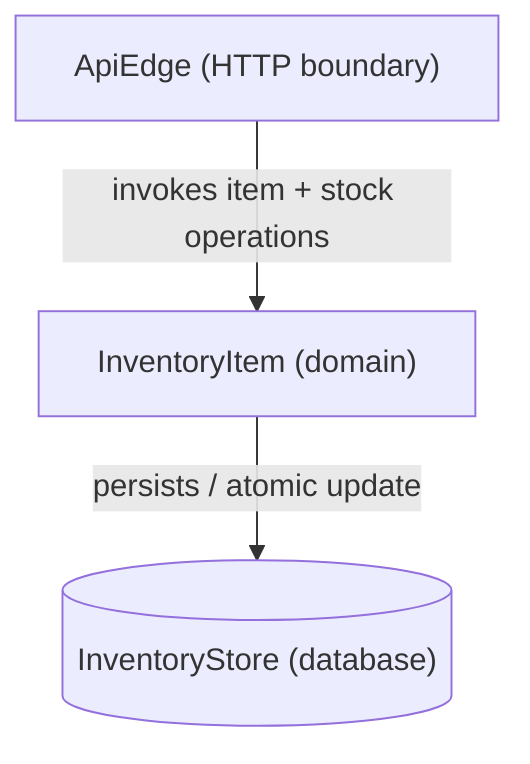

# Component Catalogue — Inventory Management REST API (MVP)

> Logical building blocks (code we write), not deployment topology or tech stack.
> Realizes the user stories ([stories]) and requirements ([requirements]);
> conventions from [team-practices] (handler → service → repository layering,
> single error envelope, boundary validation).

## Sources

- `requirements` (Requirements Analysis) — FR1–FR3, NFR1–NFR3.
- `stories` (User Stories) — US1.1–US4.2.
- `team-practices` (Practices Discovery) — layering, error-envelope, validation,
  concurrency-safe adjustment conventions.

## Part A — Component Catalogue (source of truth)

```yaml
components:
  - name: InventoryItem
    summary: Owns the inventory item and its stock quantity, including CRUD and concurrency-safe adjustments.
    behaviour: >
      Creates, reads, lists (paginated), updates descriptive fields, and hard-deletes items keyed by
      client-supplied SKU; rejects duplicate SKUs on create. Applies relative-delta stock adjustments
      atomically so concurrent adjustments cannot lose updates; rejects a decrement that would drop
      quantity below zero (InsufficientStock) leaving quantity unchanged. Quantity is changed only via
      adjustment, never via item update. Raises typed domain errors (ItemNotFound, DuplicateSku,
      InsufficientStock) for the edge to map.
    responsibilities:
      - Own the Item entity and its persistence via the repository
      - Enforce the stock-adjustment business rules (atomicity, zero floor)
      - Enforce SKU uniqueness and item lifecycle (create/update/delete)
    depends_on: []
    dependents:
      - component: ApiEdge
        interaction: ApiEdge invokes item CRUD and stock-adjustment operations to serve requests
    external_dependencies:
      - name: InventoryStore
        kind: database
        purpose: Persist items and their current stock levels; support atomic conditional updates for adjustments
    entities:
      - name: Item
        identifier: sku
        attributes: [sku, name, description, quantity]
        references: []
  - name: ApiEdge
    summary: HTTP boundary — request validation, error-envelope mapping, health check, and structured logging.
    behaviour: >
      Validates and sanitizes every request body and path/query parameter at the boundary before any
      domain logic runs; rejects invalid input with a 400 validation envelope. Maps typed domain errors
      from InventoryItem to the single consistent JSON error envelope and HTTP status (ItemNotFound 404,
      DuplicateSku 409, InsufficientStock 4xx, ValidationError 400, unexpected 500). Emits a structured
      log entry per request (requestId, method, route, outcome) and serves the health endpoint.
    responsibilities:
      - Validate/sanitize inputs at the API boundary
      - Apply the single error envelope and typed-error-to-status mapping
      - Provide the health endpoint and structured request logging
    depends_on:
      - component: InventoryItem
        interaction: Invoke item CRUD and stock-adjustment operations to serve API requests
        style: sync
    dependents: []
    external_dependencies: []
    entities: []
```

## Part B — Human-Readable View

### Component Diagram



<!-- Text fallback: ApiEdge is the HTTP boundary; it validates requests, maps
errors, logs, and serves health, and it synchronously invokes InventoryItem for
all item and stock operations. InventoryItem owns the Item entity and its stock
quantity and persists to a single InventoryStore database. No cycles. -->

### Component Summary

| Component | Purpose | Depends On | Dependents | Entities Owned |
|-----------|---------|------------|------------|----------------|
| ApiEdge | HTTP boundary: validation, error mapping, health, logging | InventoryItem | — | — |
| InventoryItem | Item CRUD + concurrency-safe stock adjustments | — | ApiEdge | Item |

### Entity Ownership

| Entity | Owning Component | Identifier | Attributes | References |
|--------|------------------|------------|------------|------------|
| Item | InventoryItem | sku | sku, name, description, quantity | — |

### External Dependencies

| Component | Dependency | Kind | Purpose |
|-----------|------------|------|---------|
| InventoryItem | InventoryStore | database | Persist items + stock levels; atomic conditional updates for adjustments |

### Rationale

| Component | Why it is a separate building block |
|-----------|-------------------------------------|
| InventoryItem | Owns the domain data and business rules (one entity, one lifecycle, the atomic-adjustment invariant). Keeping the stock quantity with the item it belongs to keeps the highest-risk path inside one ownership boundary. |
| ApiEdge | Distinct concern and change rate: the HTTP/validation/error-mapping/logging boundary changes for transport reasons, not domain reasons. Separating it keeps the domain component free of transport coupling and makes the adjustment logic unit-testable without HTTP. |

**Alternatives Rejected:** splitting item CRUD and stock adjustment into two
domain components (`ItemCatalog` + `StockLedger`) was rejected because the stock
quantity is an attribute of the item, so the split would push the single most
important (atomic) path across a component boundary for no MVP benefit. See
decisions.md ADR-001.


## Review

**Verdict:** READY
**Reviewer:** aidlc-architecture-reviewer-agent
**Date:** 2026-10-01T14:51:28Z
**Iteration:** 1

### Findings

| # | Severity | Location | Finding | Recommendation |
|---|---|---|---|---|
| 1 | Minor | traceability.json US3.1 row / decisions.md ADR-002 | US3.1 (consistent error contract) is mapped `OK → ApiEdge` only, but the behaviour it realizes is split across both components: ApiEdge owns the envelope/status mapping while `InventoryItem` must *raise* the typed domain errors (`ItemNotFound`, `DuplicateSku`, `InsufficientStock`) that ApiEdge maps — components.md `InventoryItem.behaviour` states exactly this. The single-component trace target under-represents the shared realization. | Non-blocking. Optionally widen the US3.1 target to `ApiEdge, InventoryItem` so the trace surfaces that the typed-error contract is co-realized. The co-dependency is already documented in both components' behaviour, so a developer would not be misled. |
| 2 | Minor | components.md `InventoryItem.behaviour` vs decisions.md ADR-003 | `InventoryItem.behaviour` names three typed errors (`ItemNotFound`, `DuplicateSku`, `InsufficientStock`); team-practices and requirements OQ2 also contemplate a `ConcurrencyConflict` typed error. Domain Design is silent on whether a concurrency conflict is a caller-visible domain error of `InventoryItem`. This is correctly deferred (ADR-003 Consequences + requirements OQ2), so it is a noted open thread, not an omission. | Non-blocking. The human should note the error set is not closed until the concurrency mechanism and `ConcurrencyConflict` visibility are settled in Functional/Contract Design (requirements OQ2). No action required at this stage. |
| 3 | Minor | components.md Entity Ownership / FR1 vs FR2 | The `Item` entity carries `quantity` as a plain attribute with no note that it is mutable only via the adjustment path (not via item update). The CRUD-vs-adjustment ownership boundary is clear in `InventoryItem.behaviour` ("Quantity is changed only via adjustment, never via item update") and in US1.4/AC1.4.3, but the entity-shape table alone does not convey it. | Non-blocking. Entity *shape* (not constraints) is the correct depth for this stage per the stage spec; the mutability rule legitimately belongs to Functional Design. Flagging only so the human sees the invariant is carried in prose, not in the entity table. |

### Summary

The component catalogue is well-formed and the design is implementable without architectural guesswork, so this advisory pass reaches READY. The catalogue holds every structural rule: two uniquely-named components (`ApiEdge`, `InventoryItem`), symmetric `depends_on`/`dependents` (ApiEdge→InventoryItem, mirrored), no self-dependency, an acyclic graph, the `Item` entity owned by exactly one component with identifier `sku`, and the datastore correctly modeled as an `InventoryStore` external_dependency rather than a component. Traceability is complete: all ten user stories (US1.1–US1.5, US2.1, US2.2, US3.1, US4.1, US4.2) map to a component with status `OK` and no GAP or orphan, consistent with the stories artifact. The three ADRs each satisfy the inception guardrail (Context, Decision, Consequences, Alternatives Rejected), and the central single-`InventoryItem`-component decision (ADR-001) is well-justified against NFR1 — keeping the stock quantity and its atomic-adjustment invariant inside one ownership boundary is the sound call and avoids pushing the highest-risk path across a component seam. Scope is respected throughout (single location, no auth, concrete datastore/tech-stack deferred), and I found no contradiction across components.md, decisions.md, and traceability.json. The three findings are all Minor clarifications for downstream design: a narrow US3.1 trace row that under-states the ApiEdge↔InventoryItem co-realization of the error contract, the deferred `ConcurrencyConflict` visibility question (already OQ2), and the quantity-mutability invariant living in prose rather than the entity table. Zero Critical, zero Major — none blocks approval.
